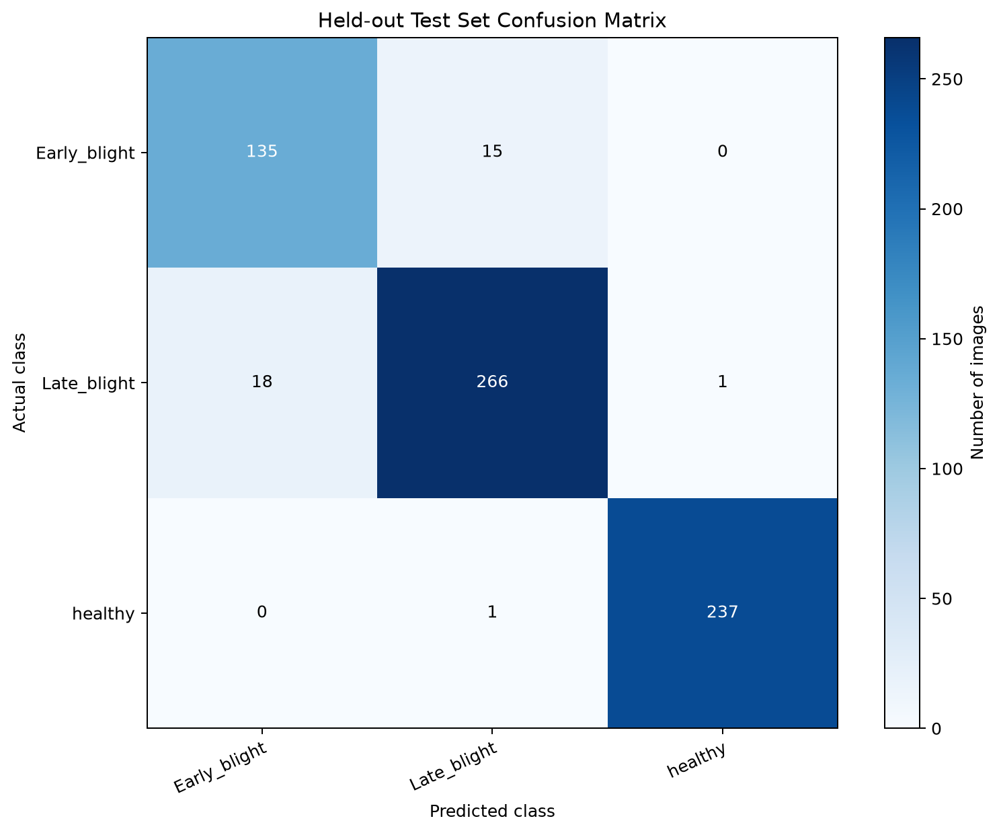

# Held-out test evaluation — Phase 6

## Evaluation procedure

The saved best Phase 5 checkpoint, `models/crop_disease_cnn.keras`, was loaded without retraining or architecture changes. Evaluation used only `data/test`; no training or validation images were included. The Phase 5 training runner loads only `data/train` and `data/validation`, and its recorded run metadata states `test_data_loaded: false`. The dataset preparation record reports no exact-image hash overlaps between the train, validation, and test splits.

The test loader used the following settings:

| Setting | Value |
|---|---|
| Test directory | `data/test` |
| Test images | 673 |
| Image size | 224 × 224 RGB |
| Batch size | 32 |
| Shuffle | False |
| Class order | `Tomato___Early_blight`, `Tomato___Late_blight`, `Tomato___healthy` |
| Checkpoint input/output | `(None, 224, 224, 3)` / `(None, 3)` |

The observed class order exactly matches the model's three output classes.

## Measured test results

| Metric | Value |
|---|---:|
| Keras test loss | 0.1226756 |
| Test accuracy | 0.9479941 (94.80%) |
| Macro precision | 0.9404712 (94.05%) |
| Macro recall | 0.9430439 (94.30%) |
| Macro F1-score | 0.9417197 (94.17%) |
| Weighted precision | 0.9482656 (94.83%) |
| Weighted recall | 0.9479941 (94.80%) |
| Weighted F1-score | 0.9480992 (94.81%) |

### Per-class report

| Class | Precision | Recall | F1-score | Support |
|---|---:|---:|---:|---:|
| Tomato___Early_blight | 0.8824 | 0.9000 | 0.8911 | 150 |
| Tomato___Late_blight | 0.9433 | 0.9333 | 0.9383 | 285 |
| Tomato___healthy | 0.9958 | 0.9958 | 0.9958 | 238 |

The weighted values are weighted by class support; macro values give each class equal weight. The independently counted accuracy from the confusion matrix agrees with the Keras test accuracy.

## Confusion matrix

Rows are actual labels and columns are predicted labels. Diagonal cells are correct predictions; off-diagonal cells are errors.

| Actual \\ Predicted | Early blight | Late blight | Healthy | Actual total |
|---|---:|---:|---:|---:|
| Early blight | **135** | 15 | 0 | 150 |
| Late blight | 18 | **266** | 1 | 285 |
| Healthy | 0 | 1 | **237** | 238 |
| Predicted total | 153 | 282 | 238 | 673 |

Correct predictions: 638 / 673. Incorrect predictions: 35 / 673.



## Performance analysis

- **Best-class performance:** Tomato___healthy was classified best, with precision, recall, and F1-score all 0.9958 (237 of 238 healthy images correct).
- **Most difficult class:** Tomato___Early_blight had the lowest F1-score, 0.8911. Of 150 actual early-blight images, 15 were predicted as late blight; its precision (0.8824) was also the lowest, reflecting predictions of early blight for some late-blight images.
- **Main confusion:** early and late blight were confused with each other in both directions: 15 early-blight images were predicted as late blight, and 18 late-blight images were predicted as early blight (33 total cross-blight errors). There were also two healthy/late-blight errors, one in each direction. No healthy image was predicted as early blight, and no early-blight image was predicted as healthy.
- **Validation comparison:** best Phase 5 validation accuracy was 96.5825%; held-out test accuracy is 94.7994%, lower by 1.7831 percentage points. Test loss was 0.1226756; the best validation loss was 0.0867663.
- **Overfitting assessment:** the Phase 5 history already showed late-run validation deterioration (at epoch 19, validation accuracy was 88.11% and validation loss was 0.30814, compared with the selected epoch-14 validation accuracy of 96.58% and loss of 0.08677). This supports an overfitting/instability concern in later epochs. However, the selected checkpoint's test accuracy is relatively close to its best validation accuracy, so these test results do not indicate a large generalization collapse for the selected checkpoint. A single split cannot establish the absence of overfitting.
- **Generalization:** the checkpoint correctly classified 94.80% of this previously held-out test set, indicating strong measured generalization to these unseen PlantVillage images. The result is limited to this dataset and split; it does not establish performance on field images or real-world disease prevalence.

## Reproduction and artifacts

Run the evaluation script from the project root:

```powershell
.venv\Scripts\python.exe src\evaluate.py
```

It loads the saved checkpoint and only the test split; it does not call `fit()` or alter model weights. Generated Phase 6 artifacts:

- `results/confusion_matrix.png` — labeled 3 × 3 confusion matrix.
- `results/classification_report.txt` — precision, recall, F1-score, and support for each class plus overall, macro, and weighted summaries.
- `results/test_results.json` — numeric metrics, class-wise scores, confusion matrix, configuration, and validation comparison.
- `src/evaluate.py` — reproducible evaluation and artifact-generation script.
